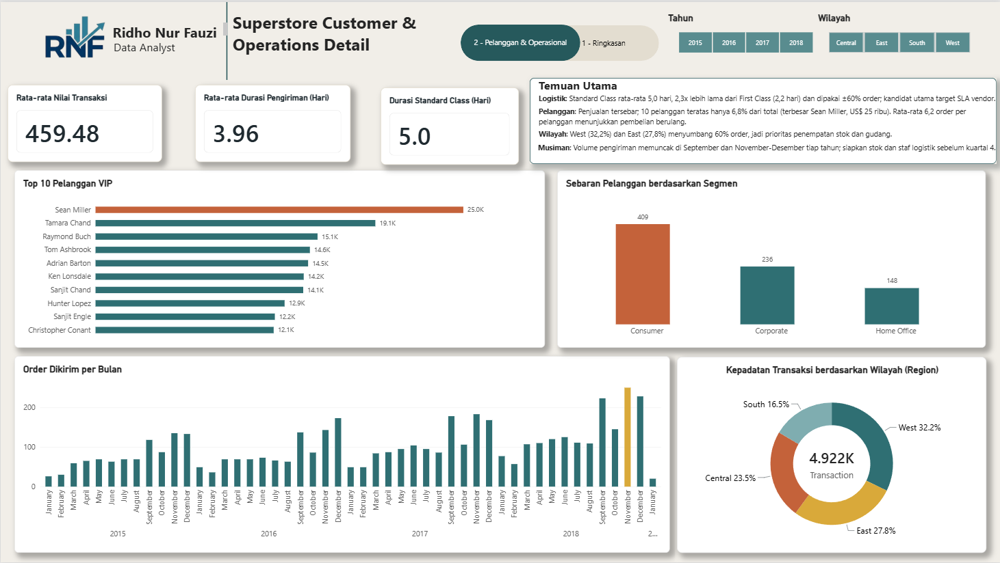

# 📊 Superstore Sales & Operations Performance Dashboard

Halo! Selamat datang di repositori proyek analisis data saya. 

Proyek ini adalah *dashboard* interaktif yang dibangun menggunakan **Power BI** untuk menganalisis data fiktif dari jaringan ritel "Superstore". Menariknya, pada dataset ini saya menantang diri sendiri untuk melakukan analisis mendalam *tanpa* menggunakan variabel metrik `Profit` (karena keterbatasan data historis). 

Oleh karena itu, fokus utama *dashboard* ini saya pivot ke arah **Perilaku Pelanggan (Customer Behavior)** dan **Efisiensi Logistik (Operational Lead Time)**. 

---

## 🚀 Live Dashboard & Akses File

**Coba Dashboard Interaktif:**
Anda dapat mencoba berinteraksi langsung dengan *dashboard* ini (berpindah halaman, mengklik filter slicer, melihat *tooltips*) melalui tautan publik Power BI berikut:
🔗 **[Live Superstore Dashboard](https://app.powerbi.com/view?r=eyJrIjoiMWE5ZDg3YjctOTJiNS00YWY0LWE5YjUtYmY3OThiY2Q4YTdlIiwidCI6ImY4NjQ5NTQ2LTdjMTctNGNhMS1iMzcyLTI4Njg4NGRlZjRhOCJ9)**

**Unduh Model Data:**
Jika Anda tertarik untuk mengeksplorasi langkah demi langkah (*behind the scenes*), melihat skema relasi data (*Star Schema*), dan formula DAX secara lengkap, silakan unduh file `.pbix` yang telah saya lampirkan di dalam repositori ini.

---

## 🎯 Objektif Proyek (Business Goals)
Alih-alih hanya menampilkan rekapitulasi data penjualan standar, *dashboard* ini dirancang untuk menjawab pertanyaan strategis berikut:
1. **Identifikasi Pasar:** Siapa pelanggan terbesar kita dan di wilayah mana transaksi paling padat terjadi?
2. **Performa Produk:** Kategori dan produk spesifik apa yang menjadi pendorong utama (*key driver*) volume penjualan?
3. **Efisiensi Logistik:** Seberapa cepat rata-rata waktu pengiriman barang (*Lead Time*) ke pelanggan berdasarkan metode pengiriman yang dipilih?

---

## 🖼️ Tampilan Dashboard

### Halaman 1: Executive Summary
Halaman ini memberikan gambaran tingkat tinggi (*high-level overview*) mengenai volume transaksi dan distribusi penjualan.


### Halaman 2: Customer & Operations Detail
Halaman ini membedah metrik lebih dalam ke level operasional, menyoroti rata-rata nilai keranjang belanja (AOV) dan performa waktu pengiriman.



---

## 💡 Temuan Kunci (Key Insights)

Dari visualisasi yang telah dibangun, berikut adalah 3 wawasan bisnis utama yang bisa ditindaklanjuti (*actionable insights*):

1. **Dominasi Segmen 'Consumer' di Wilayah Barat:** 
   Wilayah *West* (32.04%) terutama negara bagian California, mendominasi pesanan secara keseluruhan. Dari segi demografi, segmen *Consumer* menyumbang lebih dari setengah total penjualan (53.2%) dibandingkan *Corporate* atau *Home Office*. 
   * **Rekomendasi:** Perusahaan dapat mengalokasikan *budget* pemasaran/diskon yang lebih agresif khusus untuk segmen B2C (Consumer) di area West Coast untuk mendongkrak retensi.

2. **Kesenjangan Waktu Pengiriman (Bottleneck Logistik):**
   Secara keseluruhan, rata-rata waktu pengiriman (*Lead Time*) adalah 3.96 hari. Namun, ada ketimpangan drastis pada `Standard Class` yang memakan waktu penuh hingga **5 hari** rata-rata, padahal metode ini menyumbang volume pengiriman terbesar (hampir 3.000 pesanan).
   * **Rekomendasi:** Tim logistik perlu mengevaluasi *Service Level Agreement* (SLA) dengan vendor ekspedisi pengiriman standar. Jika bisa ditekan menjadi 3-4 hari, kepuasan pelanggan secara masif akan meningkat.

3. **Ketergantungan pada VIP Customers:**
   Rata-rata Nilai Transaksi (AOV) berada di angka 226.49K. Namun, jika kita melihat grafik Top 10 VIP, pelanggan seperti **Anna Gayman (24.9M)** dan **Craig Molinari (14.8M)** memberikan kontribusi yang sangat jauh di atas rata-rata.
   * **Rekomendasi:** Buat program *Loyalty/VIP Tier* khusus untuk klien-klien penggerak omzet ini agar mereka tidak berpindah ke kompetitor.

---

## 🛠️ Implementasi Teknis (Behind the Scenes)

Dalam menyusun *dashboard* ini, saya menerapkan beberapa teknik pemrosesan di Power BI:
- **Pemodelan Data:** Mengatur relasi tabel (*Star Schema* jika ada) agar filter antar-halaman berjalan mulus.
- **UI/UX Design:** Menggunakan skema warna monokromatik korporat dan menyediakan *Navigation Pane* (tombol arah panah) agar eksekutif bisa berpindah halaman layaknya menggunakan aplikasi web.
- **Custom DAX Measures:** Karena metrik operasional tidak tersedia secara bawaan, saya menulis kalkulasi DAX kustom, contohnya untuk menghitung *Lead Time*:
  
```dax
  Lead Time = AVERAGEX(Fact_Sales, DATEDIFF(Fact_Sales[Order Date], Fact_Sales[Ship Date], DAY))
```