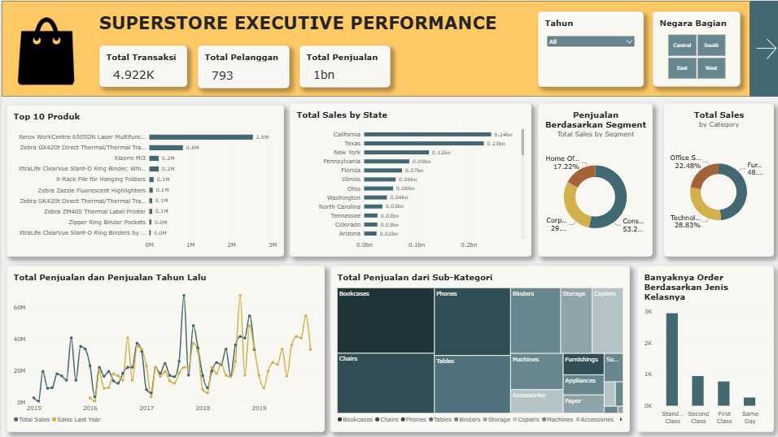

# 📊 Superstore Sales & Operations Performance Dashboard

**Author:** Ridho Nur Fauzi | Data Analyst  
**Tools Used:** Power BI, Power Query, DAX  
**Dataset:** Superstore Sales (`train.csv`, 9.800 baris, nilai dalam US$)

Halo! Selamat datang di repositori proyek analisis data saya.

Proyek ini adalah *dashboard* interaktif 2 halaman yang dibangun menggunakan **Power BI** untuk menganalisis data fiktif dari jaringan ritel "Superstore". Pada dataset ini saya menantang diri sendiri untuk melakukan analisis mendalam *tanpa* menggunakan metrik `Profit` (karena kolom tersebut tidak tersedia di data).

Oleh karena itu, fokus utama *dashboard* ini saya arahkan ke **Perilaku Pelanggan (Customer Behavior)**, **Efisiensi Logistik (Operational Lead Time)**, dan **Pola Musiman Penjualan**.

---

## 🚀 Live Dashboard & Akses File

**Coba Dashboard Interaktif:**
Anda dapat berinteraksi langsung dengan *dashboard* ini (berpindah halaman, mengklik filter slicer Tahun dan Wilayah, melihat *tooltips*) melalui tautan publik Power BI berikut:
🔗 **[Live Superstore Dashboard](https://app.powerbi.com/view?r=eyJrIjoiMWE5ZDg3YjctOTJiNS00YWY0LWE5YjUtYmY3OThiY2Q4YTdlIiwidCI6ImY4NjQ5NTQ2LTdjMTctNGNhMS1iMzcyLTI4Njg4NGRlZjRhOCJ9&pageName=be9d72f12e396d8da893)**

**Unduh Model Data:**
Jika Anda tertarik mengeksplorasi langkah demi langkah (*behind the scenes*), melihat skema relasi data (*Star Schema*), dan formula DAX secara lengkap, silakan unduh file `.pbix` yang saya lampirkan di dalam folder `model/` pada repositori ini.

---

## 📊 Ringkasan Data & KPI

| Metrik | Nilai |
|---|---|
| **Periode order** | 3 Januari 2015 – 30 Desember 2018 |
| **Jumlah baris data (item pesanan)** | 9.800 |
| **Total Transaksi (order unik)** | 4.922 |
| **Total Pelanggan** | 793 |
| **Total Penjualan** | US$ 2,26 juta (US$ 2.261.537) |
| **Rata-rata Nilai Transaksi (AOV)** | US$ 459,48 |
| **Rata-rata Durasi Pengiriman (Lead Time)** | 3,96 hari |
| **Durasi Standard Class** | 5,0 hari |

> **Catatan:** 9.800 adalah jumlah *baris* (item pesanan), sedangkan *Total Transaksi* dihitung dari **order unik** (`Order ID`), sehingga satu order dengan beberapa item tidak terhitung ganda.

---

## 🎯 Objektif Proyek (Business Goals)

Alih-alih hanya menampilkan rekapitulasi data penjualan standar, *dashboard* ini dirancang untuk menjawab pertanyaan strategis berikut:
1. **Identifikasi Pasar:** Siapa pelanggan terbesar dan di wilayah mana transaksi paling padat terjadi?
2. **Performa Produk:** Kategori dan produk spesifik apa yang menjadi pendorong utama (*key driver*) penjualan?
3. **Efisiensi Logistik:** Seberapa cepat rata-rata waktu pengiriman barang (*Lead Time*) ke pelanggan berdasarkan metode pengiriman yang dipilih?
4. **Pola Musiman:** Kapan volume penjualan dan pengiriman memuncak, sehingga stok dan tenaga logistik bisa disiapkan lebih awal?

---

## 🖼️ Tampilan Dashboard

### Halaman 1: Ringkasan Eksekutif
Halaman ini memberikan gambaran tingkat tinggi (*high-level overview*): KPI utama (transaksi, pelanggan, penjualan), Top 5 produk, penjualan per negara bagian, komposisi penjualan per kategori dan segmen, tren penjualan dibanding tahun lalu, penjualan per sub-kategori, dan jumlah order per kelas pengiriman.



### Halaman 2: Pelanggan & Operasional
Halaman ini membedah metrik lebih dalam ke level pelanggan dan operasional: rata-rata nilai transaksi (AOV), durasi pengiriman, Top 10 pelanggan VIP, sebaran pelanggan per segmen, jumlah order dikirim per bulan, dan distribusi transaksi per wilayah.


---

## 💡 Temuan Kunci (Key Insights)

Dari visualisasi yang dibangun, berikut adalah 4 wawasan bisnis utama yang bisa ditindaklanjuti (*actionable insights*):

1. **Segmen Consumer, Kategori Technology, dan Dominasi Wilayah Barat:**
   Segmen *Consumer* menyumbang 50,8% penjualan, sementara *Technology* adalah kategori terbesar (36,6%), disusul *Furniture* (32,2%) dan *Office Supplies* (31,2%). Wilayah *West* (32,2% order) dan *East* (27,8%) bersama-sama menyumbang 60% order. California dan New York saja menyumbang sepertiga (33,3%) total penjualan.
   * **Rekomendasi:** Alokasikan promosi dan stok lebih agresif untuk segmen Consumer di wilayah West dan East untuk mendongkrak retensi.

2. **Kesenjangan Waktu Pengiriman (Bottleneck Logistik):**
   Rata-rata waktu pengiriman (*Lead Time*) keseluruhan adalah 3,96 hari. Namun `Standard Class` memakan waktu rata-rata **5,0 hari**, atau 2,3x lebih lama dari `First Class` (2,2 hari), padahal metode ini dipakai oleh **59,8% order** (2.945 dari 4.922 order). `Same Day` hanya 5,3% dari order.
   * **Rekomendasi:** Tim logistik perlu mengevaluasi *Service Level Agreement* (SLA) dengan vendor ekspedisi untuk pengiriman standar. Jika durasinya bisa ditekan menjadi 3–4 hari, kepuasan pelanggan berpotensi meningkat.

3. **Penjualan Tersebar, Tidak Bergantung pada Segelintir VIP:**
   Rata-rata Nilai Transaksi (AOV) adalah US$ 459,48. Pelanggan terbesar, **Sean Miller**, menyumbang US$ 25 ribu (1,1% total penjualan), dan 10 pelanggan teratas hanya menyumbang **6,8%** dari seluruh penjualan. Dengan rata-rata 6,2 order per pelanggan, pembelian berulang terjadi di basis pelanggan yang luas.
   * **Rekomendasi:** Rancang program *Loyalty* yang menyasar basis pelanggan luas, dengan *VIP Tier* khusus untuk pelanggan teratas agar mereka tetap bertahan.

4. **Pola Musiman dan Tren Pertumbuhan:**
   Penjualan 2018 (US$ 722 ribu) naik 20,3% dibanding 2017. Kuartal 4 menyumbang 38,5% penjualan (di atas porsi merata 25%), dengan puncak di November–Desember. Volume pengiriman memuncak di September dan November–Desember setiap tahun.
   * **Rekomendasi:** Siapkan stok dan tambahan staf logistik sebelum kuartal 4.

---

## 🧹 Data Cleaning & Validasi

- **Format desimal (*locale*):** Kolom `Sales` sempat terbaca dengan *locale* Indonesia (titik dianggap pemisah ribuan), sehingga total penjualan membengkak ±490x (US$ 2,26 juta menjadi ±1,1 miliar). Diperbaiki lewat *Change Type → Using Locale* (English - United States). Kolom tanggal tetap berformat dd/mm/yyyy.
- **Order unik vs baris:** Jumlah transaksi dihitung dengan *distinct count* `Order ID` (4.922), bukan jumlah baris (9.800), agar konsisten di semua visual.
- **Top N berdasarkan nilai:** Grafik Top 5 Produk dan Top 10 Pelanggan diurutkan berdasarkan *Sum of Sales*, bukan urutan abjad nama.
- **Validasi silang:** Angka pada dashboard dicocokkan ulang dengan perhitungan langsung dari file sumber (total penjualan, jumlah order dan pelanggan, lead time per kelas pengiriman, serta pangsa segmen, kategori, dan wilayah).

---

## 🛠️ Implementasi Teknis (Behind the Scenes)

Dalam menyusun *dashboard* ini, saya menerapkan beberapa teknik di Power BI:
- **Pemodelan Data:** Mengatur relasi antar tabel (*Star Schema*) agar filter antar-halaman berjalan mulus.
- **UI/UX Design:** Skema warna monokromatik teal dengan aksen amber dan terakota, tab navigasi antar halaman layaknya aplikasi web, slicer **Tahun** dan **Wilayah** yang tersinkron di kedua halaman, serta kotak *Temuan Utama* di setiap halaman.
- **Custom DAX Measures:** Karena metrik operasional tidak tersedia secara bawaan, saya menulis kalkulasi DAX kustom, contohnya:

```dax
Total Transaksi = DISTINCTCOUNT(Fact_Sales[Order ID])

Total Pelanggan = DISTINCTCOUNT(Fact_Sales[Customer ID])

Average Order Value = DIVIDE(SUM(Fact_Sales[Sales]), [Total Transaksi])

Lead Time = AVERAGEX(Fact_Sales, DATEDIFF(Fact_Sales[Order Date], Fact_Sales[Ship Date], DAY))
```

---

## 📁 Struktur Repositori

```text
.
├── data/
│   └── train.csv                     # Dataset Superstore
├── model/
│   └── Superstore Dashboard.pbix     # File Power BI (Star Schema & DAX)
├── images/
│   ├── Halaman_1.png                 # Ringkasan Eksekutif
│   └── Halaman_2.png                 # Pelanggan & Operasional
└── README.md
```

---

## ⚠️ Keterbatasan

1. Dataset bersifat fiktif dan tidak memuat kolom `Profit`, sehingga analisis tidak mencakup profitabilitas.
2. Data order mencakup Januari 2015 – Desember 2018. Pengiriman Januari 2019 hanya berasal dari order akhir Desember 2018, sehingga batang terakhir pada grafik pengiriman bulanan kecil.
3. Dataset tidak memuat target SLA. Rekomendasi SLA berasal dari perbandingan durasi antar kelas pengiriman, bukan dari target resmi.
4. Teks pada kotak *Temuan Utama* bersifat statis (angka berlaku untuk semua tahun dan wilayah) dan tidak berubah saat slicer dipilih.
5. Pada data sumber terdapat 32 `Product ID` yang memiliki lebih dari satu nama produk; analisis produk dilakukan berdasarkan `Product Name`.

---

## 📬 Kontak

**Ridho Nur Fauzi**  
Data Analyst & ML/DL Engineer / Data Scientist

* 🌐 Portfolio: [ridhonurfauzi.netlify.app](https://ridhonurfauzi.netlify.app/)
* 💼 Terbuka untuk diskusi kolaborasi proyek data analytics, data science & machine learning

---

<p align="center"><em>Dibuat sebagai bagian dari proyek portofolio analisis data menggunakan dataset Superstore.</em></p>
